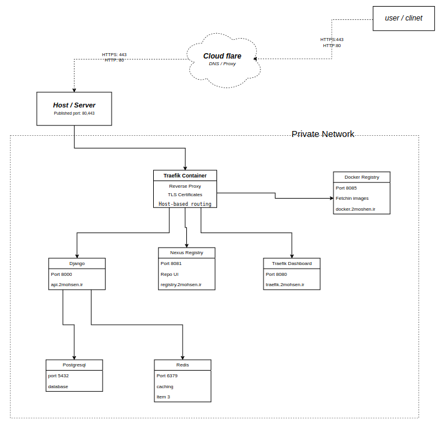
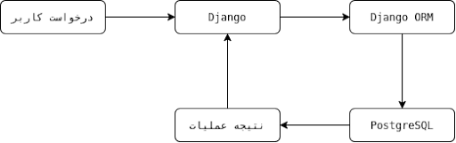

# بخش اول: بررسی زیرساخت و نحوه استقرار برنامه

## **۱. معرفی مخزن و هدف آن**

این بخش برای فراهم کردن زیرساخت لازم جهت اجرای برنامه شبکه اجتماعی طراحی شده است. در یک پروژه نرم‌افزاری، آماده بودن کد برنامه به‌تنهایی برای ارائه یک سرویس قابل استفاده کافی نیست. برنامه باید روی سرور اجرا شود، به پایگاه داده دسترسی داشته باشد، درخواست‌های کاربران را دریافت کند و سرویس‌های مورد نیاز خود را در اختیار داشته باشد.

علاوه بر این، مدیریت دسترسی کاربران، پیکربندی ارتباطات شبکه، نگهداری اطلاعات پس از راه‌اندازی مجدد کانتینرها و مدیریت تصاویر Docker نیز از مسائل مهم در زمان استقرار هستند.

این مخزن با استفاده از فناوری‌هایی مانند Docker، Docker Compose، Traefik و Nexus، بخش مهمی از این نیازها را پوشش می‌دهد.

بر اساس ساختار بررسی‌شده این پروژه، اجزای اصلی زیرساخت عبارت‌اند از:

* **Docker:** اجرای برنامه‌ها و سرویس‌ها در محیط‌های ایزوله.  
* **Docker Compose:** تعریف سرویس‌ها، شبکه‌ها، متغیرهای محیطی و فضای ذخیره‌سازی مورد نیاز.  
* **Traefik:** دریافت درخواست‌های ورودی و هدایت آن‌ها به سرویس مناسب.  
* **Nexus:** میزبانی مخزن خصوصی تصاویر کانتینری.  
* **Django و Gunicorn:** اجرای برنامه وب و پاسخ‌گویی به درخواست‌ها.  
* **PostgreSQL:** ذخیره اطلاعات اصلی برنامه.  
* **Redis:** فراهم کردن حافظه سریع برای داده‌های موقت و کش.  
* **RabbitMQ:** فراهم کردن زیرساخت صف پیام برای ارتباطات ناهم‌زمان.

*نکته مهم این است که وجود تنظیمات یک سرویس در فایل‌های پروژه لزوماً به معنای فعال بودن تمام قابلیت‌های آن در زمان اجرا نیست. به همین دلیل، در این گزارش میان سرویس‌های تعریف‌شده در پیکربندی و قابلیت‌هایی که واقعاً در مسیر اجرای برنامه استفاده می‌شوند، تفاوت قائل می‌شویم.*

## **۲. ساختار کلی مخزن زیرساخت**

در سطح اصلی مخزن، بخش‌هایی با مسئولیت‌های متفاوت وجود دارند:

| مسئولیت | بخش |
| ----- | ----- |
| فایل‌ها و تنظیمات مربوط به استقرار برنامه | application/ |
| تنظیمات مرتبط با سرویس Nexus | nexus/ |
| تنظیمات مربوط به پروکسی و مسیریابی درخواست‌ها | traefik/ |
| تعریف سرویس‌ها و ارتباطات زیرساختی | compose.yml |
| اسکریپت مرتبط با سخت‌سازی امنیتی محیط سرور | hardening.sh |

فایل compose.yml یکی از مهم‌ترین قسمت‌های این مخزن است؛ زیرا اجزای اصلی زیرساخت و نحوه ارتباط آن‌ها را در یک ساختار مشخص تعریف می‌کند.   
با استفاده از Docker Compose می‌توان سرویس‌های مختلف را به‌صورت هماهنگ راه‌اندازی کرد، شبکه مشترک آن‌ها را مشخص کرد و برای داده‌های ماندگار، فضای ذخیره‌سازی تعریف کرد.

البته جزئیات دقیق اجرای هر سرویس به تنظیمات همان سرویس، فایل‌های وابسته، متغیرهای محیطی و نسخه ایمیج های Docker نیز بستگی دارد.

## **۳. مفهوم کانتینر سازی و نقش Docker در پروژه**

برای درک نحوه استقرار این پروژه، ابتدا باید با مفهوم کانتینر سازی آشنا شویم.

کانتینر محیطی ایزوله برای اجرای یک برنامه است که کد برنامه، وابستگی‌های مورد نیاز و تنظیمات اجرایی آن را در کنار هم قرار می‌دهد. با این روش، برنامه می‌تواند در محیط‌های مختلف با رفتار قابل پیش‌بینی‌تری اجرا شود.

برای مثال، در این پروژه پایگاه داده PostgreSQL و برنامه Django به‌صورت دو سرویس مستقل اجرا می‌شوند. در نتیجه، هر کدام محیط اجرایی و تنظیمات مخصوص خود را دارند، اما از طریق شبکه Docker با یکدیگر ارتباط برقرار می‌کنند.

این روش چند مزیت مهم دارد:

* **جداسازی سرویس‌ها:** خطا یا تغییرات یک سرویس لزوماً به تغییر مستقیم سرویس دیگر نیاز ندارد.  
* **مدیریت آسان‌تر:** می‌توان سرویس‌ها را به‌صورت مستقل راه‌اندازی، متوقف و بررسی کرد.  
* **قابلیت تکرار استقرار:** با استفاده از فایل‌های پیکربندی، می‌توان محیط اجرای پروژه را با تنظیمات مشابه دوباره ایجاد کرد.  
* **مدیریت وابستگی‌ها:** هر سرویس وابستگی‌های اجرایی خودش را دارد.  
* **استفاده بهتر از منابع:** چند سرویس می‌توانند روی یک سرور اجرا شوند، بدون اینکه لازم باشد برای هر سرویس یک ماشین مجازی مستقل ایجاد شود.

البته کانتینر با ماشین مجازی تفاوت دارد. کانتینرها معمولاً هسته سیستم‌عامل میزبان را به اشتراک می‌گذارند؛ درحالی‌که ماشین‌های مجازی سیستم‌عامل مستقل خود را اجرا می‌کنند.

## 

## **۴. نقش Docker Compose در هماهنگی سرویس‌ها**

Docker Compose ابزاری برای تعریف و مدیریت چند سرویس مرتبط با یکدیگر است.  
در یک پروژه واقعی، اجرای جداگانه هر سرویس می‌تواند پیچیده و مستعد خطا باشد. برای مثال، ممکن است لازم باشد ابتدا پایگاه داده راه‌اندازی شود، سپس برنامه وب اجرا شود و بعد از آن تنظیمات شبکه و دسترسی به سرویس‌های دیگر بررسی شوند.  
Docker Compose این اطلاعات را در یک فایل پیکربندی، مانند compose.yml، گردآوری می‌کند.

در این فایل می‌توان موارد زیر را تعریف کرد:

* تصویر یا روش ساخت هر سرویس؛  
* نام سرویس‌ها؛  
* متغیرهای محیطی؛  
* شبکه‌های ارتباطی؛  
* فضای ذخیره‌سازی ماندگار؛  
* پورت‌های باز شده روی سرور؛  
* برچسب‌های موردنیاز Traefik؛  
* وابستگی‌های اجرایی میان سرویس‌ها.

بنابراین، فایل Compose را می‌توان نقشه اجرایی زیرساخت پروژه دانست.  
برای مثال، اگر برنامه Django به پایگاه داده‌ای با نام سرویس db متصل شود، معمولاً می‌توان نام میزبان پایگاه داده را در تنظیمات اتصال به شکل زیر قرار داد:  
*Db:5432*

در این آدرس، db نام سرویس در شبکه Docker و 5432 پورت پیش‌فرض PostgreSQL است.

## **۵. بررسی ارتباط کانتینرهای پروژه**

یکی از مهم‌ترین قسمت‌های این زیرساخت، ارتباط میان سرویس‌های مختلف است.  
در این پروژه، شبکه‌ای با نام **web\_net** برای ارتباط سرویس‌ها در نظر گرفته شده است. این شبکه امکان برقراری ارتباط میان کانتینرهای متصل به آن را فراهم می‌کند.  
وجود شبکه مشترک به این معنی نیست که تمام سرویس‌ها باید مستقیماً در معرض اینترنت باشند. سرویس‌ها می‌توانند در شبکه داخلی با یکدیگر ارتباط برقرار کنند، درحالی‌که فقط پورت‌های ضروری روی سرور منتشر می‌شوند.

### ***۵.۱. نمودار معماری کانتینرها***

این نمودار، رابطه منطقی اجزای زیرساخت را نشان می‌دهد؛  

برای مثال، درخواست معمول ورود کاربر به شبکه اجتماعی از Traefik به Django می‌رسد و برای بررسی اطلاعات کاربر، Django با PostgreSQL ارتباط برقرار می‌کند. در چنین درخواستی، نیازی نیست RabbitMQ حتماً درگیر شود.  
همچنین  Nexus یا docker registry بخشی از مسیر معمول پردازش درخواست کاربران نیست. نقش آن بیشتر به مدیریت و توزیع تصاویر کانتینری در فرایند استقرار مربوط می‌شود.

### ***۵.۲. چرا سرویس‌ها در کانتینرهای جداگانه قرار گرفته‌اند؟***

جداسازی سرویس‌ها باعث می‌شود هر جزء وظیفه مشخصی داشته باشد.  
برای مثال، PostgreSQL مسئول نگهداری داده‌هاست، Redis برای دسترسی سریع به داده‌ها استفاده می‌شود و Traefik درخواست‌های ورودی را مدیریت می‌کند.  
این جداسازی چند مزیت دارد:

1. تغییر نسخه Redis لزوماً به تغییر مستقیم نسخه PostgreSQL نیاز ندارد.  
2. می‌توان لاگ هر سرویس را به‌صورت جداگانه بررسی کرد.  
3. در صورت بروز مشکل، یافتن منشا خطا آسان‌تر می‌شود.  
4. امکان تنظیم منابع و سیاست‌های اجرایی هر سرویس به‌صورت مستقل فراهم می‌شود.  
5. می‌توان هر سرویس را با توجه به نیازهای همان بخش نگهداری و به‌روزرسانی کرد.

بااین‌حال، جداسازی کانتینرها به‌خودی‌خود باعث مقیاس‌پذیری کامل یا دسترس‌پذیری بالا نمی‌شود. این قابلیت‌ها به تنظیمات تکمیلی، مدیریت داده‌ها، سلامت سرویس‌ها و نحوه استقرار نیز وابسته‌اند.

## 

## **۶. Traefik و نقش آن در دریافت درخواست‌های کاربران**

Traefik یکی از اجزای کلیدی این زیرساخت است.  
Traefik یک Reverse Proxy یا پروکسی معکوس است. پراکسی معکوس درخواست کاربران را دریافت می‌کند و بر اساس قواعد تعریف‌شده، آن‌ها را به سرویس مقصد هدایت می‌کند.  
در این پروژه، Traefik در نقطه ورودی زیرساخت قرار دارد و ارتباط میان کاربران و سرویس‌های داخلی را مدیریت می‌کند.

### ***۶.۱. پراکسی معکوس چگونه کار می‌کند؟***

فرض کنیم کاربری آدرس دامنه برنامه را در مرورگر خود وارد می‌کند.  
در یک استقرار متداول با Traefik، فرایند به شکل زیر انجام می‌شود:  
۱. مرورگر کاربر به دامنه برنامه متصل می‌شود.  
۲. درخواست به سرور میزبان می‌رسد.  
۳. Traefik درخواست را دریافت می‌کند.  
۴. Traefik با بررسی اطلاعات درخواست، مانند نام میزبان، تشخیص می‌دهد که درخواست به کدام سرویس تعلق دارد.  
۵. درخواست به کانتینر برنامه Django منتقل می‌شود.  
۶. Django درخواست را پردازش می‌کند و پاسخ را به Traefik بازمی‌گرداند.  
۷. Traefik پاسخ را به کاربر ارسال می‌کند.

### ***۶.۲. چرا از Traefik استفاده شده است؟***

استفاده از Traefik مزایای زیر را فراهم می‌کند:

* مدیریت متمرکز درخواست‌های ورودی؛  
* مسیریابی درخواست‌ها بر اساس دامنه و قواعد تعریف‌شده؛  
* امکان استفاده از HTTPS و مدیریت گواهی‌های TLS؛  
* امکان هدایت درخواست‌ها به چند سرویس مختلف؛  
* کاهش نیاز به تعریف دستی مسیرها در یک پراکسی ثابت؛  
* امکان توسعه زیرساخت و افزودن سرویس‌های جدید.

Traefik می‌تواند از طریق Docker Provider اطلاعات کانتینرها و برچسب‌های آن‌ها را دریافت کند و بر اساس این اطلاعات، قواعد مسیریابی را ایجاد کند.

### ***۶.۳. نقش HTTPS و گواهی TLS***

ارتباط HTTPS باعث می‌شود داده‌های مبادله‌شده میان مرورگر و نقطه ورودی سرور، در مسیر انتقال رمزنگاری شوند.  
در این معماری، Traefik می‌تواند مسئول دریافت ارتباط HTTPS و مدیریت گواهی TLS باشد. این فرایند معمولاً با عنوان TLS Termination شناخته می‌شود.  
پس از برقراری ارتباط امن با Traefik، درخواست می‌تواند از طریق شبکه داخلی به برنامه Django منتقل شود.  
البته امن بودن ارتباط داخلی نیز به نحوه پیکربندی شبکه و سیاست‌های امنیتی بستگی دارد. استفاده از HTTPS در نقطه ورودی، به‌تنهایی به معنی رمزنگاری تمام ارتباطات داخلی نیست.  
همچنین فعال بودن HTTPS به تنظیم صحیح DNS، دسترسی به پورت‌های لازم، معتبر بودن گواهی و هماهنگی تنظیمات Traefik وابسته است.

## **۷. Nexus و مدیریت تصاویر Docker**

سرویس مهم دیگر در این زیرساخت، Nexus است.  
Nexus Repository Manager برای مدیریت و میزبانی انواع مخازن نرم‌افزاری استفاده می‌شود. در این پروژه، نقش مورد نظر آن میزبانی مخزن خصوصی تصاویر Docker است.

### ***۷.۱. چرا به مخزن خصوصی تصاویر نیاز داریم؟***

تصاویر Docker معمولاً از مخازن عمومی دریافت می‌شوند. بااین‌حال، در پروژه‌های سازمانی یا پروژه‌هایی که نیاز به کنترل بیشتر دارند، ممکن است لازم باشد تصاویر اختصاصی برنامه در یک مخزن خصوصی نگهداری شوند.  
برای مثال، تصویر ساخته‌شده از برنامه Django می‌تواند در Nexus ذخیره شود تا سرور هنگام استقرار آن را از همان مخزن دریافت کند.  
این روش امکان مدیریت متمرکز تصاویر را فراهم می‌کند و به تیم توسعه اجازه می‌دهد نسخه‌های مختلف برنامه را در یک مخزن مشخص نگهداری کند.

## **۸. PostgreSQL؛ پایگاه داده اصلی برنامه**

PostgreSQL پایگاه داده رابطه‌ای مورد استفاده برنامه است.  
یک شبکه اجتماعی باید اطلاعاتی مانند کاربران، مشخصات حساب‌ها، نوشته‌ها و ارتباط میان کاربران را نگهداری کند. این اطلاعات ساختارمند هستند و به روابط میان موجودیت‌های مختلف نیاز دارند؛ به همین دلیل، پایگاه داده رابطه‌ای گزینه مناسبی برای آن‌هاست.  
در این پروژه، Django از طریق ORM خود با PostgreSQL ارتباط برقرار می‌کند.  
ORM مخفف Object-Relational Mapping است. این فناوری امکان تعامل با پایگاه داده را از طریق مدل‌ها و اشیای زبان برنامه‌نویسی فراهم می‌کند.  
برای مثال، به‌جای نوشتن مستقیم تمام دستورات SQL، برنامه‌نویس می‌تواند از مدل Django برای ایجاد یا بازیابی اطلاعات استفاده کند.

روند کلی به شکل زیر است:

پایگاه داده در این معماری یک سرویس مستقل است؛ بنابراین، برنامه Django به‌جای نگهداری داده‌ها در حافظه داخلی خود، آن‌ها را در سرویس PostgreSQL ذخیره می‌کند.

### ***۸.۱. اهمیت Volume در نگهداری اطلاعات***

کانتینرها می‌توانند متوقف یا حذف شوند و دوباره ساخته شوند. اگر داده‌های مهم فقط در لایه قابل‌حذف کانتینر نگهداری شوند، امکان از دست رفتن آن‌ها وجود دارد.  
برای جلوگیری از این مشکل، Docker امکان استفاده از Volume را فراهم می‌کند.  
در پروژه، تعریف فضای ذخیره‌سازی ماندگار برای داده‌های PostgreSQL اهمیت زیادی دارد؛ زیرا اطلاعات کاربران و نوشته‌ها نباید با بازسازی کانتینر پایگاه داده از بین بروند.  
البته Volume جایگزین پشتیبان‌گیری نیست. برای حفاظت مناسب از اطلاعات، باید نسخه پشتیبان تهیه شود و امکان بازیابی آن نیز آزمایش شود.

## **۹. Redis و کاربرد آن در زیرساخت**

Redis یک سامانه ذخیره‌سازی داده در حافظه است که معمولاً برای کش، داده‌های موقت و برخی کاربردهای پردازش سریع استفاده می‌شود. در معماری این پروژه، Redis در کنار PostgreSQL قرار دارد، اما وظیفه آن با پایگاه داده اصلی متفاوت است.PostgreSQL  برای نگهداری پایدار اطلاعات اصلی برنامه استفاده می‌شود، درحالی‌که Redis می‌تواند برای نگهداری موقت نتایج یا داده‌هایی که دسترسی سریع به آن‌ها اهمیت دارد، مورد استفاده قرار گیرد.

## **۹.۱. چرا از کش استفاده می‌کنیم؟**

فرض کنیم اطلاعات مشخصات یک کاربر بارها درخواست می‌شود. اگر هر بار برنامه تمام اطلاعات را از پایگاه داده بخواند، تعداد درخواست‌های تکراری به PostgreSQL افزایش پیدا می‌کند.  
در صورت استفاده از کش، برنامه می‌تواند نتیجه برخی عملیات را در Redis نگهداری کند و در درخواست‌های بعدی، در صورت معتبر بودن داده کش‌شده، آن را سریع‌تر در اختیار درخواست قرار دهد.

# 
