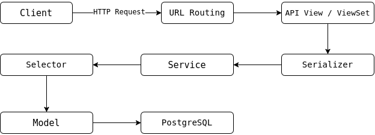

# بخش دوم: بررسی معماری داخلی برنامه در مخزن app-devops-project

## **۱. معرفی برنامه شبکه اجتماعی**

مخزن app-devops-project شامل کدهای برنامه اصلی است. این برنامه با استفاده از Django توسعه داده شده و قابلیت‌های پایه یک شبکه اجتماعی ساده را فراهم می‌کند.  
در یک شبکه اجتماعی، کاربران باید بتوانند حساب کاربری داشته باشند، وارد سیستم شوند، اطلاعات خود را مدیریت کنند و با محتوای منتشر شده توسط دیگران تعامل داشته باشند.  
برای پیاده‌سازی چنین برنامه‌ای، صرفاً ایجاد چند صفحه یا تعریف چند مدل کافی نیست. برنامه باید بتواند درخواست‌های کاربران را دریافت کند، اطلاعات ورودی را اعتبارسنجی کند، مجوزهای لازم را بررسی کند، منطق مربوط به عملیات را اجرا کند و در نهایت پاسخ مناسبی برگرداند.  
در این پروژه، معماری برنامه به‌گونه‌ای طراحی شده است که مسئولیت‌های مختلف در بخش‌های مجزا قرار بگیرند. این موضوع به خوانایی کد، نگهداری بهتر و توسعه قابلیت‌های جدید کمک می‌کند.  
از اجزای مهم معماری برنامه می‌توان به موارد زیر اشاره کرد:

* Django به‌عنوان چارچوب اصلی توسعه برنامه؛  
* Django REST Framework برای پیاده‌سازی API ها؛  
* مدل‌های Django برای تعریف ساختار داده‌ها؛  
* Serializer ها برای اعتبارسنجی و تبدیل داده‌ها؛  
* View ها برای دریافت درخواست و تولید پاسخ؛  
* Service ها برای اجرای عملیات و منطق کاربردی؛  
* Selector ها برای عملیات خواندن و بازیابی اطلاعات؛  
* PostgreSQL برای ذخیره‌سازی پایدار داده‌ها؛  
* Redis برای کش اطلاعات منتخب؛  
* JWT برای احراز هویت مبتنی بر توکن.

این اجزا با یکدیگر همکاری می‌کنند تا درخواست کاربر به یک عملیات مشخص در برنامه تبدیل شود.

## **۲. تفاوت Django و Django REST Framework در این پروژه**

برای فهم ساختار کد باید تفاوت Django و Django REST Framework را بدانیم.  
Django چارچوب اصلی برنامه است و امکاناتی مانند مدل‌ها، ORM، مسیریابی URL، تنظیمات، مدیریت کاربران و ابزارهای توسعه وب را فراهم می‌کند. در مقابل، Django REST Framework مجموعه‌ای از ابزارها برای ساخت API های مبتنی بر REST است. API رابطی است که امکان ارتباط برنامه‌های مختلف را با یکدیگر فراهم می‌کند.  
در این پروژه، API ها به کلاینت اجازه می‌دهند درخواست‌هایی مانند ورود کاربر، دریافت اطلاعات حساب یا انجام عملیات مربوط به شبکه اجتماعی را ارسال کند.

نمای ساده این معماری به شکل زیر است:

این نمودار، یک نمای مفهومی از اجزای برنامه است. مسیر دقیق اجرا به نوع عملیات بستگی دارد؛ برای مثال، عملیات خواندن ممکن است مستقیماً از Service به Selector برسد، درحالی‌که عملیات نوشتن باید تغییرات را از طریق ORM در پایگاه داده ثبت کند.  
همچنین Serializer در همه Endpointها الزاماً در یک جایگاه ثابت قرار نمی‌گیرد. بعضی Serializerها برای اعتبارسنجی داده ورودی و برخی برای تبدیل داده خروجی استفاده می‌شوند.

### ***۲.۱. URL Routing؛ مسیریابی درخواست‌ها***

وقتی کلاینت درخواستی به سرور ارسال می‌کند، Django باید تشخیص دهد که این درخواست مربوط به کدام بخش برنامه است. این کار از طریق سیستم مسیریابی URL انجام می‌شود.  
برای مثال، درخواست ورود کاربر باید به Endpoint مربوط به احراز هویت برسد؛ درحالی‌که درخواست دریافت نوشته‌ها باید به بخش مرتبط با نوشته‌ها هدایت شود.   
در این پروژه، فایل‌های urls.py مسئول تعریف و اتصال مسیرهای URL به Viewهای مربوط هستند.

### ***۲.۲. View؛ دریافت و پاسخ‌گویی به درخواست***

View نقطه‌ای است که درخواست وارد منطق API می‌شود.  
در Django REST Framework، View می‌تواند مسئولیت‌هایی مانند موارد زیر را بر عهده داشته باشد:

* دریافت درخواست HTTP؛  
* بررسی احراز هویت و مجوزها؛  
* دریافت داده‌های ورودی؛  
* اجرای اعتبارسنجی لازم؛  
* فراخوانی منطق مورد نیاز برنامه؛  
* تبدیل نتیجه به پاسخ HTTP.

برای مثال، هنگام درخواست دریافت نوشته‌ها، View باید عملیات مربوط را آغاز کند و نتیجه را در قالب پاسخ مناسب در اختیار کلاینت قرار دهد.  
یکی از اصول مهم طراحی این است که View تا حد امکان از جزئیات پیچیده منطق برنامه دور نگه داشته شود. به‌جای قرار دادن تمام عملیات در یک View طولانی، می‌توان منطق کاربردی را به Service و عملیات دسترسی به داده را به Selector منتقل کرد.  
این روش باعث می‌شود کد هر بخش وظیفه مشخص‌تری داشته باشد.

### ***۲.۳. Serializer؛ اعتبارسنجی و تبدیل داده‌ها***

در Django REST Framework، Serializer یکی از اجزای مهم ارتباط API با داده‌هاست. Serializer می‌تواند داده‌های دریافتی از کلاینت را بررسی کند و در صورت معتبر بودن، آن‌ها را برای استفاده در منطق برنامه آماده سازد.  
برای مثال، هنگام ثبت‌نام ممکن است لازم باشد ایمیل، رمز عبور و سایر اطلاعات ورودی بررسی شوند. اگر داده ورودی معتبر نباشد، برنامه باید خطای مناسبی به کلاینت برگرداند.  
Serializer همچنین می‌تواند اشیای Django را به داده‌هایی مانند دیکشنری تبدیل کند تا در قالب JSON به کلاینت ارسال شوند.

### ***۲.۴. Service؛ اجرای منطق کاربردی***

Serviceها برای سازمان‌دهی عملیات کاربردی برنامه استفاده می‌شوند.  
فرض کنیم کاربر قصد دارد عملیاتی انجام دهد که به چند مرحله نیاز دارد. برای مثال، ممکن است لازم باشد اطلاعات کاربر بررسی شود، محدودیت‌های دسترسی اعمال شوند و سپس تغییر موردنظر در پایگاه داده ثبت شود.  
اگر تمام این مراحل مستقیماً در View نوشته شوند، کد به‌تدریج پیچیده خواهد شد.  
با استفاده از Service، می‌توان عملیات را در یک تابع یا کلاس مستقل قرار داد و View را به بخش دریافت درخواست و برگرداندن پاسخ محدودتر کرد.  
در این معماری، Service نقش هماهنگ‌کننده عملیات را دارد.  
البته Service جایگزین مدل یا پایگاه داده نیست؛ بلکه از آن‌ها و سایر اجزای برنامه برای انجام عملیات موردنیاز استفاده می‌کند.

### ***۲.۵. Selector؛ سازمان‌دهی عملیات خواندن اطلاعات***

Selectorها در این پروژه برای سازمان‌دهی منطق بازیابی اطلاعات به کار می‌روند.  
برای مثال، برنامه ممکن است به اطلاعات پروفایل یک کاربر، نوشته‌های منتشر شده یا اطلاعات مرتبط با اشتراک‌های کاربران نیاز داشته باشد.  
به‌جای تکرار QuerySet های مشابه در چند View، می‌توان منطق دسترسی به اطلاعات را در Selector های مربوط قرار داد.  
این کار مزایای زیر را دارد:

* کاهش تکرار کد؛  
* متمرکز شدن منطق Query ها؛  
* ساده‌تر شدن بررسی عملکرد پرس‌وجوها؛  
* امکان استفاده مجدد از عملیات خواندن در بخش‌های مختلف برنامه.

برای مثال، اگر چند بخش برنامه به نوشته‌های یک کاربر نیاز داشته باشند، یک Selector مناسب می‌تواند منطق بازیابی آن نوشته‌ها را به‌صورت مشترک ارائه کند.  
البته Selectorها در این معماری مفهوم طراحی هستند و نباید آن‌ها را با قابلیت خاصی از خود Django اشتباه گرفت.

### ***۲.۶. Model؛ تعریف ساختار داده‌ها***

Modelها ساختار اطلاعاتی برنامه را تعریف می‌کنند. در Django، مدل‌ها معمولاً به جدول‌های پایگاه داده نگاشت می‌شوند و فیلدها و روابط میان داده‌ها را مشخص می‌کنند.برای مثال، یک مدل کاربر می‌تواند اطلاعات حساب کاربری را نگهداری کند و یک مدل مربوط به نوشته‌ها می‌تواند اطلاعات محتوای منتشرشده را ذخیره کند و رابطه میان مدل‌ها مشخص می‌کند که موجودیت‌های مختلف چگونه به یکدیگر وابسته‌اند. در این پروژه، مدل‌ها همراه با ORM جنگو امکان انجام عملیات پایگاه داده را از طریق کد Python فراهم می‌کنند.

## **۳. چرخه پردازش یک درخواست در برنامه**

برای درک بهتر معماری، فرض کنیم کاربر قصد دارد اطلاعات یک نوشته را از طریق API دریافت کند.  
این عملیات به‌صورت مفهومی در مراحل زیر انجام می‌شود.

### ***مرحله اول: ارسال درخواست***

کلاینت یک درخواست HTTP به Endpoint مربوط ارسال می‌کند.

### ***مرحله دوم: دریافت درخواست در سرور***

در محیط استقرار، Traefik درخواست را به کانتینر Django هدایت می‌کند. سپس سرور برنامه درخواست را دریافت می‌کند.

### ***مرحله سوم: مسیریابی در Django***

Django با استفاده از تنظیمات URL، درخواست را به View مربوط هدایت می‌کند.

### ***مرحله چهارم: بررسی ورودی و دسترسی***

اگر Endpoint نیاز به احراز هویت داشته باشد، اعتبار توکن بررسی می‌شود. در صورت وجود داده ورودی، اعتبارسنجی مناسب نیز انجام می‌شود.

### ***مرحله پنجم: اجرای منطق برنامه***

View، عملیات مورد نیاز را از طریق Service یا اجزای مرتبط اجرا می‌کند.

### ***مرحله ششم: بازیابی داده***

Selector با منطق مناسب دسترسی به اطلاعات را انجام می‌دهد. بسته به پیاده‌سازی، ممکن است ابتدا کش بررسی شود و در صورت نیاز، اطلاعات از PostgreSQL دریافت شوند.

### ***مرحله هفتم: آماده‌سازی پاسخ***

نتیجه عملیات به کمک Serializer به قالب قابل ارسال به کلاینت تبدیل می‌شود.

### ***مرحله هشتم: ارسال پاسخ***

Django پاسخ HTTP را تولید می‌کند و در محیط استقرار، پاسخ از طریق Traefik به کلاینت بازمی‌گردد.
